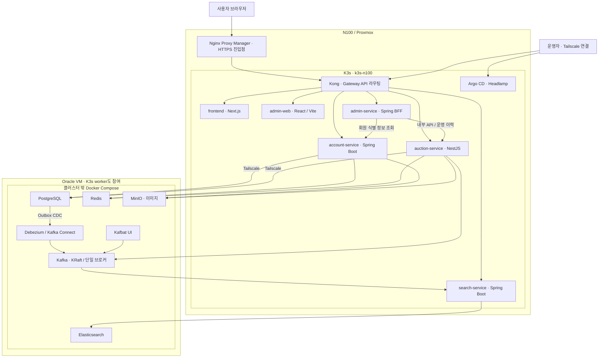
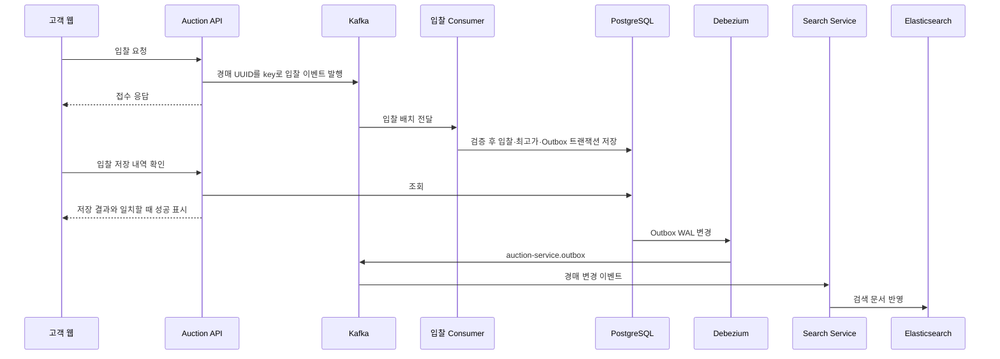
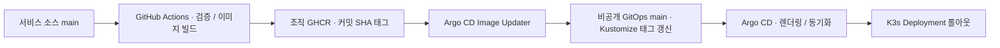

# 찰낙찰낙 운영 아키텍처

기준일: 2026-10-25. 배포 선언과 실제 클러스터를 대조한 홈랩 구성이다.
2025년 팀 프로젝트를 바탕으로 경매 중심의 포트폴리오 환경을 재구성했다.
팀 프로젝트 당시 설명과 기여자는 [원본 소개](../history/team-project-2025.md)에 보존했다.

## 배치와 책임

Tailscale은 노드 연결과 데이터 플랫폼 접근에 사용한다. 다이어그램의 서비스 간
화살표가 모두 개별 mTLS를 사용한다는 뜻은 아니다. NPM은 별도 LXC에 있으며
K3s 워크로드로 배포하지 않는다. Oracle은 worker지만 현재 앱 6개는
`workload: core` 선택자로 N100에 배치된다.

| 저장소                                                                | 실제 배포 이름            | 책임 / 주요 저장소                                                          |
| --------------------------------------------------------------------- | ------------------------- | --------------------------------------------------------------------------- |
| [FE-Service](https://github.com/5-BaeChuKimParkJo/FE-Service)         | frontend                  | 경매 탐색·입찰·낙찰자 결제 UI, Next.js 서버 측 API 호출                     |
| [member-service](https://github.com/5-BaeChuKimParkJo/member-service) | account-service           | 통합 인증·회원·프로필, PostgreSQL `cn_member`와 Redis                       |
| [node-service](https://github.com/5-BaeChuKimParkJo/node-service)     | auction-service           | 경매·입찰·결제·운영 이력·인기 순위·데모 보충, PostgreSQL `cn_auction`       |
| [search-service](https://github.com/5-BaeChuKimParkJo/search-service) | search-service            | Kafka 이벤트 소비와 Elasticsearch 검색 조회                                 |
| [chalnak-admin](https://github.com/5-BaeChuKimParkJo/chalnak-admin)   | admin-service / admin-web | 관리자 인증·CSRF, 업무 API 중계, 운영 화면과 대시보드 링크                  |
| [cncn_private](https://github.com/chuman0216/cncn_private)            | GitOps 저장소             | Kustomize·Argo CD·Helm Application·Oracle Compose·운영 절차, 접근 권한 필요 |

핵심 업무 백엔드는 account·auction·search 세 개다. 관리자 BFF와 두 웹을 포함하면
앱 Deployment는 여섯 개다. 기존 auth/member URL은 account-service로 라우팅하는
호환 경로이며 별도 auth/member Pod를 의미하지 않는다. 상품 서비스는 보류했고
채팅·알림 및 Node 저장소에 남은 catalog/notification 앱은 현재 배포에 포함하지 않는다.

## 입찰과 검색 반영

접수 응답은 낙찰이나 입찰 성공 보장이 아니다. 홈랩에서는 SSE 알림 없이
경매·입찰자·금액이 일치하는 저장 내역을 조회해 입찰 결과를 확인한다. 최고
입찰자의 연속 입찰과 본인 경매 입찰은 제한한다. 결과가 불명확하면 자동으로
재입찰하지 않고 내역을 확인한다.

경매 DB가 원본이고 Elasticsearch는 검색용 사본이다. Outbox를 업무 변경과
같은 DB 트랜잭션에 저장해 DB와 이벤트를 따로 쓰는 간격을 줄인다. 이후 CDC·Kafka·검색
구간에는 지연과 재처리가 발생할 수 있다. 전체 경로의 즉시 정합성이나 정확히
한 번 처리 보장을 주장하지 않는다. 기존 입찰 Consumer에는 배치 오류 시
offset commit 후 DLQ를 발행하는 경로가 있어, 실패 복구와 DLQ 원자성은 별도 개선 과제다.

## 낙찰자 결제와 관리자 처리

1. 종료된 경매의 인증된 최고 입찰자만 결제를 준비한다.
2. 경매 잠금과 주문 생성으로 구매자·판매자·금액을 고정하고 입찰 변경을 막는다.
3. 고객은 Toss **테스트 결제** 창을 사용한다. 서버가 주문·소유자·금액을 검증하고
   제공자 승인을 확인한 뒤 결제 완료로 기록한다.
4. 승인·취소 결과가 불명확하면 동일 요청과 저장된 멱등성 키로 상태를 확인한다.
   새 주문이나 중복 결제로 해결하지 않는다. 현재 복구는 명시적 조회 또는 알려진 주문의 webhook으로 수행한다.
5. 관리자 BFF는 내부 토큰과 운영자를 전달해 조회·전액 취소·처리 이력을 제공한다.
   BFF에서 경매 DB를 직접 조회하지 않으며 Toss 비밀 키는 Auction Service에만 둔다.

선입찰 보증금, 실결제, 판매자 정산, 부분 환불은 현재 범위 밖이다. 대시보드의
미결제 기한 경과 표시는 운영 판단 정보이며 자동 취소 기능이 아니다.

## 자동 데모와 이미지

- 데모 보충은 기존 Auction Service가 5분마다 수행한다. 서버 설정이 정확한 문자열
  `true`일 때만 실행하며 시작 시 즉시 실행하지 않는다.
- 설정된 템플릿 또는 비공개 provenance로 연결된 자식 중 활성 경매가 없으면 한 건 만든다.
  시작가는 1,000원이고 현재 UTC 정각부터 24시간이므로 생성 후 23~24시간 남는다.
- 수동·자동 생성은 같은 트랜잭션 advisory lock을 사용한다. 경매·표식·Outbox는 함께
  커밋한다. 기존 입찰·결제·이미지를 리셋하거나 가짜 활동으로 순위를 올리지 않는다.
- 이미지 저장은 MinIO다. API 이름에 presigned URL이 남아 있어도 현재 업로드는
  서명된 POST URL과 필드를 사용하는 방식이다. 앱 서버가 접근 가능한 MinIO에 전송하고
  브라우저에는 서비스 이미지 경로를 제공한다. 프로필 미설정 시 `penguins.svg`를 사용한다.

## 배포와 운영 결정

| 결정                                 | 이유                                                               | 현재 감수하는 제약                                                  |
| ------------------------------------ | ------------------------------------------------------------------ | ------------------------------------------------------------------- |
| EKS 중심 구성을 K3s 홈랩으로 단순화  | 기존 장비에서 배포·유지보수를 반복하고 설명 가능한 포트폴리오 구성 | 컨트롤 플레인 1대, 장비 재부팅 시 서비스 중단 가능                  |
| 업무 백엔드를 세 개로 축소           | 회원·인증을 합치고 경매와 검색의 이벤트 연동은 유지                | 기존 소스와 미배포 코드가 함께 남음                                 |
| 데이터 플랫폼을 Oracle Docker로 분리 | 앱 Pod 롤아웃과 데이터 컨테이너 수명주기를 분리                    | 같은 Oracle 호스트 장애는 공유하며 HA·백업을 대체하지 않음          |
| PostgreSQL과 서비스별 DB·사용자      | 운영 엔진 수를 줄이고 쓰기 책임과 권한을 구분                      | 하나의 PostgreSQL 인스턴스를 공유                                   |
| Tailscale과 공개 진입점 구분         | 내부 콘솔·DB 접근을 제한하고 고객 웹은 NPM으로 제공                | Tailnet 연결만으로 앱 인증·RBAC가 대체되지는 않음                   |
| GitOps와 SHA 이미지 태그             | 실행 버전과 선언 변경을 커밋으로 추적                              | 새 이미지만 게시해서는 완료되지 않으며 GitOps 변경·동기화 확인 필요 |

Argo CD는 클러스터 리소스를 관리한다. Oracle의 Docker Compose 데이터 서비스는
별도 호스트 운영 절차를 사용하며 Argo CD가 직접 동기화하지 않는다. Kustomize는
매니페스트를 렌더링하는 도구이고 독립 업무 Pod가 아니다. 플랫폼 구성에는 Helm도 함께 사용한다.

## 다음에 확장할 영역

백업·복구 훈련, 메트릭·로그 수집과 알림, 단일 장애 지점 완화, Kafka 실패 복구와
재처리 검증을 운영 과제로 남겨둔다. 채팅·알림 재도입과 데이터 분석·MLOps는
유저와 데이터가 늘 때 별도 요구사항으로 다룬다. 현재 HA·부하 성능이나 실제 사용자 규모를 입증한 프로젝트로 표현하지 않는다.

다음 문서: [체험 순서](demo-guide.md) · [검증 근거](verification.md).
